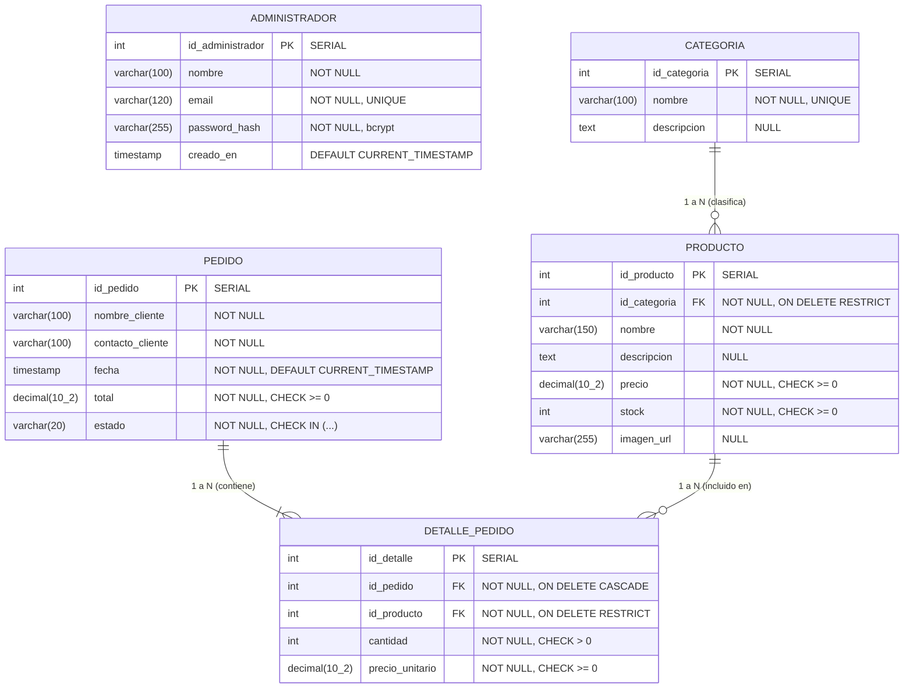

# Modelo de Datos — Tienda en Línea Modular

Este documento detalla el diseño de la base de datos relacional PostgreSQL para el proyecto, especificando las entidades, sus relaciones, atributos, restricciones de integridad y las justificaciones de cada decisión de arquitectura de datos.

---

## 1. Diagrama Entidad-Relación (Mermaid)

El siguiente diagrama refleja la estructura formal implementada en [`schema.sql`](file:///c:/Users/elpeo/OneDrive/Documentos/Desarrollo%20Web/Proyecto%20WEB/docs/schema.sql):

---

## 2. Diccionario de Datos y Especificación de Entidades

### 2.1. `administrador`
Entidad independiente encargada de salvaguardar las credenciales de los usuarios con privilegios sobre el panel privado (RF-05). No mantiene relaciones de clave foránea con las entidades comerciales de la tienda.

| Atributo | Tipo de Dato | Nulidad | Restricciones / Reglas | Descripción |
| :--- | :--- | :--- | :--- | :--- |
| `id_administrador` | `SERIAL` (`INT`) | NOT NULL | **PK** | Identificador secuencial único. |
| `nombre` | `VARCHAR(100)` | NOT NULL | - | Nombre completo del administrador. |
| `email` | `VARCHAR(120)` | NOT NULL | **UNIQUE**, `CHECK` regex formato email | Correo institucional o corporativo para inicio de sesión. |
| `password_hash` | `VARCHAR(255)` | NOT NULL | Hash `bcrypt` | Resumen criptográfico de la contraseña (mínimo 10 rondas de salt). |
| `creado_en` | `TIMESTAMP` | NOT NULL | `DEFAULT CURRENT_TIMESTAMP` | Fecha de creación del registro. |

### 2.2. `categoria`
Agrupación jerárquica de primer nivel para los artículos del catálogo (RF-01, RF-03).

| Atributo | Tipo de Dato | Nulidad | Restricciones / Reglas | Descripción |
| :--- | :--- | :--- | :--- | :--- |
| `id_categoria` | `SERIAL` (`INT`) | NOT NULL | **PK** | Identificador numérico de la categoría. |
| `nombre` | `VARCHAR(100)` | NOT NULL | **UNIQUE** | Denominación única de la categoría (ej. "Calzado Deportivo"). |
| `descripcion` | `TEXT` | NULL | - | Detalle o alcance de los productos pertenecientes a la categoría. |

### 2.3. `producto`
Artículos comercializados en la tienda virtual con control de existencias físicas y fijación de precios (RF-02, RF-03, RF-07).

| Atributo | Tipo de Dato | Nulidad | Restricciones / Reglas | Descripción |
| :--- | :--- | :--- | :--- | :--- |
| `id_producto` | `SERIAL` (`INT`) | NOT NULL | **PK** | Identificador secuencial del producto. |
| `id_categoria` | `INT` | NOT NULL | **FK** $\to$ `categoria(id_categoria)` | Categoría a la que pertenece obligatoriamente. |
| `nombre` | `VARCHAR(150)` | NOT NULL | - | Nombre comercial del producto. |
| `descripcion` | `TEXT` | NULL | - | Descripción detallada de especificaciones y características. |
| `precio` | `DECIMAL(10,2)` | NOT NULL | `CHECK (precio >= 0)` | Precio de venta al público en moneda local. |
| `stock` | `INT` | NOT NULL | `CHECK (stock >= 0)` | Cantidad de unidades físicas disponibles para compra. |
| `imagen_url` | `VARCHAR(255)` | NULL | - | URL pública de la imagen representativa del producto. |

### 2.4. `pedido`
Cabecera de transacción comercial generada por un cliente tras confirmar su carrito (RF-06, RF-08). No requiere inicio de sesión ni registro previo de usuarios clientes.

| Atributo | Tipo de Dato | Nulidad | Restricciones / Reglas | Descripción |
| :--- | :--- | :--- | :--- | :--- |
| `id_pedido` | `SERIAL` (`INT`) | NOT NULL | **PK** | Número consecutivo del pedido. |
| `nombre_cliente` | `VARCHAR(100)` | NOT NULL | - | Nombre del comprador para rotulación de la orden. |
| `contacto_cliente` | `VARCHAR(100)` | NOT NULL | - | Teléfono o correo suministrado para seguimiento comercial. |
| `fecha` | `TIMESTAMP` | NOT NULL | `DEFAULT CURRENT_TIMESTAMP` | Fecha y hora exacta de registro de la orden. |
| `total` | `DECIMAL(10,2)` | NOT NULL | `CHECK (total >= 0)` | Importe total liquidado y validado en backend. |
| `estado` | `VARCHAR(20)` | NOT NULL | `CHECK (estado IN ('PENDIENTE', 'CONFIRMADO', 'EN_PREPARACION', 'COMPLETADO', 'CANCELADO'))` | Estado administrativo del pedido (por defecto `'PENDIENTE'`). |

### 2.5. `detalle_pedido`
Líneas de pedido que descomponen los productos adquiridos, resolviendo la relación N a M entre `pedido` y `producto`.

| Atributo | Tipo de Dato | Nulidad | Restricciones / Reglas | Descripción |
| :--- | :--- | :--- | :--- | :--- |
| `id_detalle` | `SERIAL` (`INT`) | NOT NULL | **PK** | Identificador consecutivo del renglón de detalle. |
| `id_pedido` | `INT` | NOT NULL | **FK** $\to$ `pedido(id_pedido)` | Pedido al que pertenece el ítem. |
| `id_producto` | `INT` | NOT NULL | **FK** $\to$ `producto(id_producto)` | Producto adquirido. |
| `cantidad` | `INT` | NOT NULL | `CHECK (cantidad > 0)` | Número de unidades compradas (mínimo 1). |
| `precio_unitario` | `DECIMAL(10,2)` | NOT NULL | `CHECK (precio_unitario >= 0)` | Precio vigente del producto capturado en el instante de compra. |

---

## 3. Justificación de Decisiones de Diseño

### 3.1. Políticas de Claves Foráneas (`ON DELETE`)

1. **`categoria` $\to$ `producto` (`ON DELETE RESTRICT`):**
   * *Justificación:* Si un administrador intenta eliminar una categoría que aún posee productos asociados, el motor de base de datos bloquea la operación. Esto previene productos huérfanos con `id_categoria` inexistente o nulo (lo cual rompería la navegación del catálogo en el frontend). El administrador debe reclasificar o eliminar los productos previamente.
2. **`producto` $\to$ `detalle_pedido` (`ON DELETE RESTRICT`):**
   * *Justificación:* Si un producto ya ha sido vendido y figura en órdenes registradas, queda terminantemente prohibido su borrado físico. Esto preserva la trazabilidad contable y el historial de ventas del negocio. Para descontinuar un artículo sin alterar órdenes pasadas, se debe optar por fijar su `stock` en `0` o desactivarlo.
3. **`pedido` $\to$ `detalle_pedido` (`ON DELETE CASCADE`):**
   * *Justificación:* Un ítem de detalle no tiene significado ni existencia autónoma sin su cabecera de pedido. Si administrativamente se depura o elimina una orden, todas sus líneas de detalle asociadas se eliminan en cascada atómicamente, garantizando que no queden registros basura.

### 3.2. Inmutabilidad de Precios Históricos
En la entidad `detalle_pedido`, se incluye la columna redundante `precio_unitario`. 
* *Razón:* Si el precio de un producto cambia de \$89.99 a \$110.00 en la tabla `producto`, los pedidos realizados con anterioridad deben seguir reflejando que fueron vendidos a \$89.99. Calcular el total del pedido mediante un `JOIN` dinámico al precio actual de `producto` provocaría alteraciones retroactivas inaceptables en los registros de auditoría y facturación.

### 3.3. Manejo del Carrito de Compras (Frontend vs. Backend)
* De acuerdo con el alcance del PDF (Sección 3.2 y 6.1), el **carrito no es una entidad persistente en la base de datos**.
* El carrito reside temporalmente en el estado del cliente en el frontend (reactivo con Vue y almacenado en `localStorage`).
* Solo se materializa en la base de datos como una tupla en `pedido` y $N$ tuplas en `detalle_pedido` en el instante en que el cliente ejecuta la acción de confirmación ("Checkout").

### 3.4. Transaccionalidad y Concurrencia al Confirmar Pedidos
Cuando el cliente confirma un pedido:
1. El backend abre una transacción explícita (`BEGIN TRANSACTION`).
2. Se consulta el stock de cada producto involucrado utilizando bloqueo pesimista (`SELECT stock, precio FROM producto WHERE id_producto = $1 FOR UPDATE`).
3. Se verifica que para cada ítem: `stock >= cantidad_solicitada`. Si no hay existencias suficientes, se aborta la transacción con `ROLLBACK` y se retorna error `409 Conflict` o `422 Unprocessable Entity`.
4. Se descuenta el stock de cada producto: `UPDATE producto SET stock = stock - cantidad WHERE id_producto = $1`.
5. Se calcula el total en backend a partir de los precios oficiales en base de datos.
6. Se inserta la cabecera en `pedido` y los renglones en `detalle_pedido`.
7. Se ejecuta `COMMIT`.

### 3.5. Indexación Estratégica
* **`idx_producto_id_categoria`:** Garantiza que el filtro del catálogo por categoría responda en tiempo $O(\log n)$ sin realizar escaneos completos de tabla (`Sequential Scan`).
* **`idx_producto_nombre_trgm` (Trigrama con GIN):** La búsqueda por palabras clave (`RF-07`) mediante `ILIKE '%termino%'` normalmente degrada a `Seq Scan`. Con el índice de trigramas de PostgreSQL, las búsquedas difusas y de subcadenas se resuelven eficientemente mediante índice invertido.
* **`idx_pedido_fecha`:** Optimiza la consulta y ordenamiento cronológico inverso de las compras en el panel administrativo.
